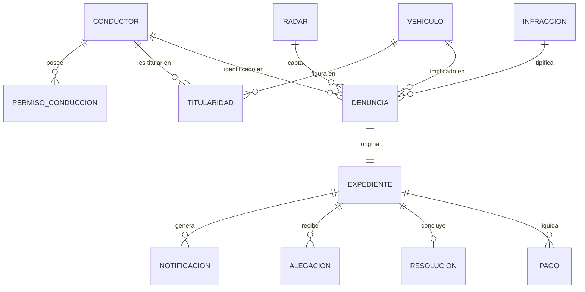
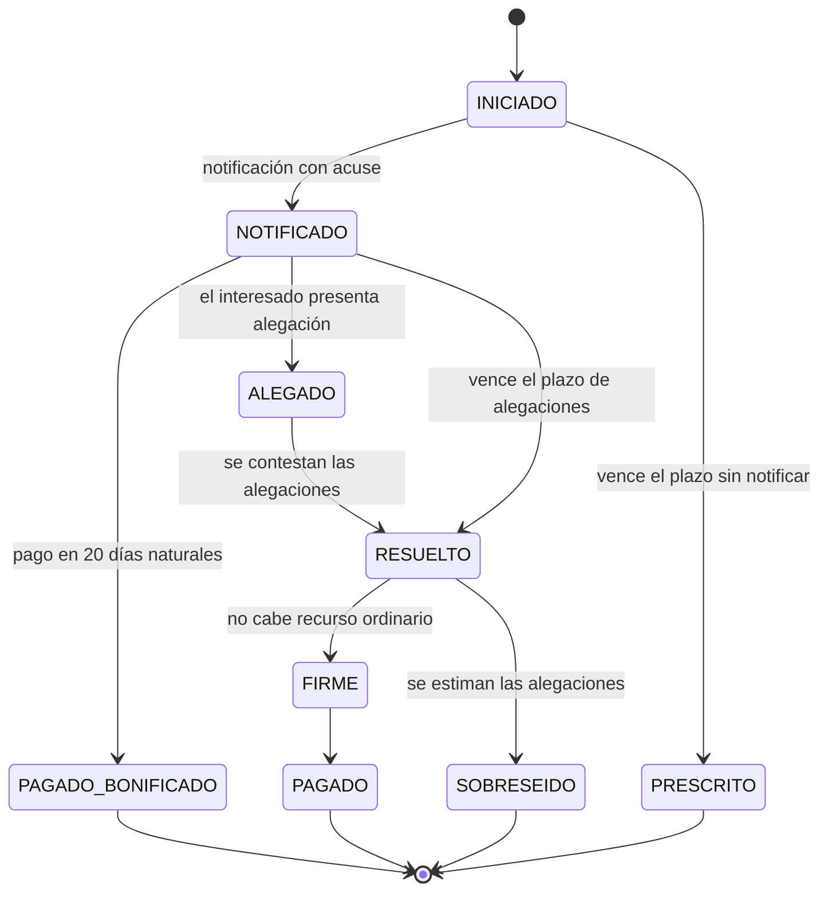

import NextPageButton from '@site/src/components/NextPageButton';

# El proyecto MULTAGAL

**MULTAGAL — Sistema de gestión de sanciones de tráfico.**

Durante todo el curso desarrollarás el subsistema de tramitación de expedientes
sancionadores de una administración de tráfico. El sistema debe cubrir el ciclo
de vida completo de una denuncia: **captación, tramitación, notificación,
alegaciones, resolución, pago** y, en su caso, **detracción de puntos**.

:::note[Por qué este dominio]

No es un CRUD de biblioteca. Se ha elegido porque genera de forma natural los
problemas que el módulo necesita: transacciones que deben ser atómicas
(detraer puntos y suspender el permiso), datos de estructura variable (el
atestado de cada denuncia), datos geoespaciales (radares y lugares de
denuncia), ficheros externos de terceros (las captaciones de los radares) y
adjuntos binarios (las fotografías). Cada tecnología del curso encuentra aquí
un caso de uso real, no artificial.

:::

## Glosario administrativo

Antes del modelo, el vocabulario. Estos términos son del procedimiento
sancionador español y aparecerán en todos los enunciados del curso.

| Término | Significado |
|---------|-------------|
| **Denuncia** | Acto por el que un agente o un dispositivo hace constar un hecho presuntamente infractor. |
| **Expediente** | Procedimiento administrativo abierto a raíz de una denuncia. Tiene número, estado y plazos. |
| **Instructor** | Órgano que tramita el expediente. |
| **Notificación** | Comunicación formal al interesado. Puede requerir varios intentos. |
| **Alegación** | Escrito con el que el interesado se opone a la denuncia o aporta pruebas. |
| **Resolución** | Acto que pone fin al expediente: sanción firme, sobreseimiento o estimación de alegaciones. |
| **Firmeza** | Situación en la que la resolución ya no admite recurso ordinario. Sólo entonces se ejecuta. |
| **Detracción de puntos** | Descuento del saldo del permiso, que sólo ocurre con resolución firme. |
| **Prescripción** | Extinción de la responsabilidad por transcurso del plazo sin actuación administrativa. |
| **Sobreseimiento** | Archivo del expediente sin sanción. |
| **Pronto pago** | Pago anticipado con bonificación, a cambio de renunciar a alegar. |

## Entidades del dominio

| Entidad | Descripción |
|---------|-------------|
| `Conductor` | Titular de permiso de conducción. NIF/NIE, nombre, domicilio, fecha de expedición, saldo de puntos. |
| `PermisoConduccion` | Permiso asociado a un conductor, con sus clases (A, B, C…), fechas de validez y estado. |
| `Vehiculo` | Matrícula, marca, modelo, tipo, fecha de matriculación, estado de ITV. |
| `Titularidad` | Relación temporal N:M entre `Conductor` y `Vehiculo` (fecha de alta y de baja). |
| `Infraccion` | Catálogo normativo: código, artículo del Reglamento, descripción, importe base, puntos a detraer, gravedad (leve / grave / muy grave). |
| `Denuncia` | Hecho denunciado: fecha y hora, lugar (con coordenadas), agente o dispositivo denunciante, infracción imputada, vehículo, conductor identificado (si lo hay). |
| `Expediente` | Tramitación administrativa de una denuncia: número de expediente, estado, importe, fechas del procedimiento. |
| `Notificacion` | Intentos de notificación al interesado, con acuse y resultado. |
| `Alegacion` | Escrito presentado por el interesado, con documentos adjuntos. |
| `Resolucion` | Acto administrativo que pone fin al expediente. |
| `Pago` | Abonos totales o parciales, con posible bonificación por pronto pago. |
| `Radar` | Dispositivo de captación automática: identificador, ubicación, tipo, límite de velocidad controlado. |

### Relaciones principales



Fíjate en dos puntos que darán trabajo más adelante:

- **`Titularidad` es una N:M con atributos** (fecha de alta y de baja). No se
  puede resolver con un simple `@ManyToMany`: hará falta una entidad propia.
  Además es **temporal**: un vehículo puede haber tenido varios titulares, y la
  pregunta «¿quién era el titular el día de la denuncia?» no tiene una respuesta
  trivial.
- **`Conductor` puede ser nulo en `Denuncia`.** Un radar capta una matrícula, no
  una persona. La identificación del conductor es un paso posterior del
  procedimiento.

## Estados del expediente

El expediente es una máquina de estados. Casi todas las reglas de negocio son,
en realidad, restricciones sobre las transiciones válidas.



## Reglas de negocio significativas

Estas seis reglas son la fuente de complejidad del proyecto: de ellas salen las
transacciones, las validaciones y las consultas interesantes.

### R1 — Bonificación por pronto pago

> Bonificación del **50 %** del importe si el pago se produce dentro de los **20
> días naturales** siguientes a la notificación, con **renuncia a alegaciones**.

Implica: cálculo de plazos sobre fechas, y un efecto lateral — pagar cierra la
vía de alegación.

### R2 — La detracción de puntos exige firmeza

> La detracción de puntos sólo se materializa cuando la resolución es **firme**.

Implica: no basta con que exista una `Resolucion`; hay que comprobar su estado
antes de tocar el saldo del conductor.

### R3 — Saldo cero ⇒ permiso suspendido, atómicamente

> Un conductor con saldo de puntos igual a cero queda con el permiso
> **suspendido**: la actualización del saldo y el cambio de estado del permiso
> deben ser **atómicos**.

:::danger[Este es *el* caso transaccional del curso]

Esta regla se reimplementa en la UD3 (JDBC), en la UD4 (JPA) y se compara en la
UD5. Es el hilo conductor: la misma operación de negocio resuelta con
tecnologías distintas, para que veas qué cambia y qué no.

Si el `UPDATE` del saldo tiene éxito y el del permiso falla, quedas con un
conductor a 0 puntos y el permiso activo. Eso es corrupción de datos, y es
exactamente lo que una transacción evita.

:::

### R4 — Prescripción

> Prescripción de la infracción a los **3 meses** (leves) o **6 meses** (graves
> y muy graves) desde la fecha de comisión si no se ha notificado.

Implica: consultas por rango de fechas condicionadas a la gravedad, y un proceso
de purga (que en la UD1 se hará recorriendo un árbol de directorios).

### R5 — No se resuelve con alegaciones pendientes

> Un expediente no puede resolverse mientras existan alegaciones **pendientes de
> contestar**.

Implica: una validación que consulta una colección asociada antes de permitir la
transición de estado.

### R6 — Obligación de identificar al conductor

> La identificación del conductor es **obligatoria** para el titular del
> vehículo; su omisión genera una **infracción autónoma muy grave**.

Implica: un expediente puede generar otro expediente. Cuidado con las
recursividades y con las referencias circulares al serializar.

## Fases del proyecto

El desarrollo se organiza en siete fases que se corresponden con las unidades
didácticas:

| Fase | Denominación | Ev. | RA | Entregable |
|------|--------------|-----|----|------------|
| 0 | Arranque del proyecto y del entorno | 1ª | — | Repositorio inicializado, Spring Boot arrancando, Docker Compose funcional |
| 1 | Ingesta y exportación de expedientes en ficheros | 1ª | RA1, RA6.c | ENTREGA 1 |
| 2 | Persistencia relacional con JDBC | 1ª | RA2, RA6.d | ENTREGA 1 |
| 3 | Migración a JPA / Hibernate | 2ª | RA3, RA6.e | ENTREGA 2 |
| 4 | Datos objeto-relacionales y geoespaciales | 2ª | RA4, RA6.f | ENTREGA 2 |
| 5 | Expedientes documentales y evidencias | 3ª | RA5, RA6.g | ENTREGA 3 |
| 6 | Componentización, integración y despliegue | 3ª | RA6 completo | ENTREGA 3 |
| — | Prueba práctica final | 3ª | Todos | Examen de modificación |

Observa la **progresión en espiral**: la fase 3 no tira lo de la fase 2, lo
reimplementa. Al final del curso tu repositorio contendrá varias soluciones al
mismo problema, y sabrás argumentar cuál conviene en cada escenario.

## Protección de datos

El dominio maneja datos personales de categoría ordinaria pero sensible en la
práctica: NIF, domicilio, matrícula, historial sancionador.

:::warning[Exigencia del módulo]

- **No se incorporan datos reales** al proyecto en ningún momento.
- Los datos de prueba se **seudonimizan** y se generan sintéticamente.
- Se aplican los principios de **minimización** y **limitación de la
  finalidad** del RGPD: si un caso de uso no necesita el domicilio, la consulta
  no lo trae.
- Las credenciales de base de datos **nunca** van en el código fuente ni en el
  repositorio.

:::

Estos puntos se evalúan: aparecen en las condiciones formales de los
entregables descritas en la [presentación del módulo](/tema-0/a-presentacion-modulo).

## Un primer esbozo del modelo

En la actividad [A0.3](/tema-0/i-actividades) crearás los primeros POJOs del
dominio. Todavía sin persistencia: sólo tipos Java que representen los
conceptos. Un adelanto del criterio a seguir:

```java
public record Coordenadas(double latitud, double longitud) { }

public enum Gravedad { LEVE, GRAVE, MUY_GRAVE }

public record Infraccion(
        String codigo,
        String articulo,
        String descripcion,
        BigDecimal importeBase,
        int puntos,
        Gravedad gravedad) { }
```

:::tip[Sobre los tipos]

`BigDecimal` para el importe, **nunca** `double`: los importes son dinero y
`double` no representa exactamente los decimales. `LocalDate` / `LocalDateTime`
para las fechas, nunca `java.util.Date`. Estas decisiones parecen menores ahora
y se vuelven caras en la UD3, cuando haya que mapearlas a columnas.

:::

<NextPageButton to="/tema-0/c-entorno-desarrollo">
Entorno de desarrollo
</NextPageButton>
