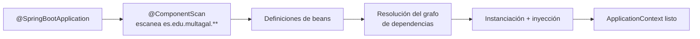
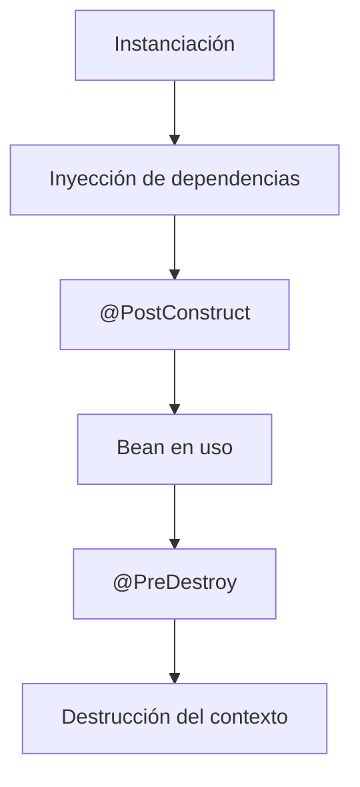
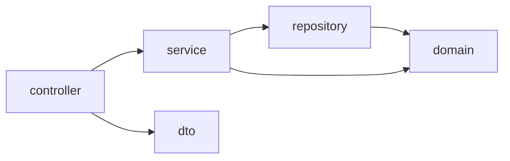

import NextPageButton from '@site/src/components/NextPageButton';

# Inversión de control e inyección de dependencias

Este es el apartado conceptualmente más importante de la UD0. Todo lo que
hagamos a partir de la UD1 se apoya en él, y el RA6 —programación de
componentes— es, en el fondo, una aplicación sistemática de estas ideas.

## El problema: acoplamiento

Empecemos por el código que **no** vamos a escribir:

```java
public class ServicioExpedientes {

    // El servicio decide él mismo qué implementación usa,
    // y la crea con new.
    private final RepositorioExpedientesJdbc repositorio =
            new RepositorioExpedientesJdbc("jdbc:mariadb://localhost:3306/multagal");

    public Expediente buscar(String numero) {
        return repositorio.buscarPorNumero(numero);
    }
}
```

Funciona. Y tiene cuatro problemas serios:

1. **Está atado a JDBC.** Para migrar a JPA en la UD4 hay que editar esta clase,
   aunque su lógica de negocio no cambie en absoluto.
2. **No se puede probar aisladamente.** Cualquier prueba de
   `ServicioExpedientes` necesita una MariaDB arrancada en `localhost:3306`.
   No hay forma de sustituir el repositorio por un doble.
3. **Lleva configuración dentro.** La URL está escrita en el código: viola la
   condición formal de los entregables.
4. **Gestiona el ciclo de vida de algo que no le corresponde.** ¿Cuándo se cierra
   ese repositorio? ¿Cuántas instancias hay si hay diez servicios?

:::info[El nombre del problema]

La clase depende de **quién** le da el servicio, no sólo de **qué** servicio
necesita. Eso es acoplamiento a la implementación.

:::

## La solución: invertir el control

**Inversión de control (IoC)** significa que una clase deja de crear y de buscar
sus dependencias: alguien externo se las proporciona. Ese alguien es el
**contenedor**.

**Inyección de dependencias (DI)** es la técnica concreta con la que el
contenedor entrega esas dependencias.

```java
@Service
public class ServicioExpedientes {

    private final RepositorioExpedientes repositorio;   // ← una INTERFAZ

    // Spring ve el constructor y busca en el contexto
    // un bean que implemente RepositorioExpedientes.
    public ServicioExpedientes(RepositorioExpedientes repositorio) {
        this.repositorio = repositorio;
    }

    public Expediente buscar(String numero) {
        return repositorio.buscarPorNumero(numero);
    }
}
```

Los cuatro problemas desaparecen:

1. El servicio depende de la **interfaz**. Cambiar de JDBC a JPA es cambiar qué
   implementación se registra, sin tocar esta clase.
2. En una prueba puedes pasarle un `Mockito.mock(RepositorioExpedientes.class)`
   por el constructor. Sin base de datos.
3. La URL vive en `application.yml`, donde le corresponde.
4. El contenedor gestiona el ciclo de vida.

:::tip[Esto no es magia de Spring]

La inyección de dependencias es un patrón de diseño, no una característica de un
framework. El segundo ejemplo funciona perfectamente sin Spring: basta con hacer
`new ServicioExpedientes(new RepositorioExpedientesJdbc(...))` en algún sitio.
Lo que aporta Spring es hacer ese cableado automáticamente para toda la
aplicación. Recuérdalo en la defensa oral.

:::

## El contenedor y los beans

Un **bean** es un objeto cuyo ciclo de vida gestiona Spring. El
**`ApplicationContext`** es el contenedor que los guarda, los crea en el orden
correcto y los conecta entre sí.

En el arranque, el contexto:

1. Escanea los paquetes buscando clases anotadas como componentes.
2. Registra su **definición** (no la instancia todavía): clase, ámbito,
   dependencias.
3. Resuelve el grafo de dependencias y decide el orden de creación.
4. Instancia cada bean, le inyecta sus dependencias e invoca sus métodos de
   inicialización.



## Los estereotipos

Todos son especializaciones de `@Component` y todos hacen que la clase se
registre como bean. La diferencia es **semántica**: comunican la intención y, en
algún caso, añaden comportamiento.

| Anotación | Capa | Qué añade |
|-----------|------|-----------|
| `@Component` | genérica | Nada. Úsala cuando ninguna otra encaja. |
| `@Service` | negocio | Nada funcional. Marca la clase como lógica de negocio. |
| `@Repository` | persistencia | **Traduce las excepciones** del proveedor (`SQLException`, excepciones de Hibernate…) a la jerarquía `DataAccessException` de Spring. |
| `@Controller` / `@RestController` | presentación | Registra la clase para el enrutado HTTP de Spring MVC. |
| `@Configuration` | configuración | La clase declara beans mediante métodos `@Bean`. |

:::note[`@Repository` sí hace algo]

La traducción de excepciones no es cosmética: convierte una `SQLException`
comprobada y específica de MariaDB en una `DataIntegrityViolationException` no
comprobada e independiente del proveedor. Eso permite que la capa de servicio
capture errores de persistencia sin conocer la tecnología subyacente. Volveremos
a ello en la UD3.

:::

## Formas de inyección

### Por constructor — la correcta

```java
@Service
public class ServicioResolucion {

    private final RepositorioExpedientes expedientes;
    private final ServicioPuntos puntos;

    public ServicioResolucion(RepositorioExpedientes expedientes,
                              ServicioPuntos puntos) {
        this.expedientes = expedientes;
        this.puntos = puntos;
    }
}
```

Desde Spring 4.3, si la clase tiene **un solo constructor**, `@Autowired` es
innecesario. Ventajas:

- Los campos pueden ser **`final`**: el objeto es inmutable y seguro entre hilos.
- Es **imposible** construir el objeto sin sus dependencias. No hay estado a
  medias.
- Se puede instanciar en una prueba sin ningún contenedor.
- Si el constructor tiene ocho parámetros, la clase está haciendo demasiado. El
  código te lo está diciendo.

### Por campo — no la uses

```java
@Service
public class ServicioResolucion {
    @Autowired                                    // ❌
    private RepositorioExpedientes expedientes;
}
```

No puede ser `final`, oculta las dependencias (hay que leer toda la clase para
saber qué necesita) y sólo se puede instanciar a través del contenedor: en una
prueba unitaria pura, el campo queda a `null`.

:::warning[Criterio del módulo]

En este módulo se exige **inyección por constructor**. La inyección por campo se
considera defecto de diseño en las revisiones de código y en la rúbrica.

:::

### Con Lombok

```java
@Service
@RequiredArgsConstructor          // genera el constructor con los campos final
public class ServicioResolucion {
    private final RepositorioExpedientes expedientes;
    private final ServicioPuntos puntos;
}
```

Equivalente a la inyección por constructor: Lombok genera el constructor en
tiempo de compilación. Aceptable, siempre que sepas explicar qué genera.

## Cuando hay varias implementaciones

Este es exactamente el caso de la actividad A7.2 —tres adaptadores del mismo
puerto— y conviene conocerlo ya.

```java
public interface RepositorioExpedientes {
    Optional<Expediente> buscarPorNumero(String numero);
}

@Repository
public class RepositorioExpedientesJdbc implements RepositorioExpedientes { ... }

@Repository
public class RepositorioExpedientesJpa implements RepositorioExpedientes { ... }
```

Con ambos registrados, Spring falla en el arranque:

```
NoUniqueBeanDefinitionException: expected single matching bean but found 2
```

Tres formas de resolverlo:

```java
// 1. @Primary — uno es el predeterminado
@Repository @Primary
public class RepositorioExpedientesJpa implements RepositorioExpedientes { }

// 2. @Qualifier — se elige explícitamente en el punto de inyección
public ServicioExpedientes(@Qualifier("repositorioExpedientesJdbc")
                           RepositorioExpedientes repo) { }

// 3. @ConditionalOnProperty — se elige por CONFIGURACIÓN
@Repository
@ConditionalOnProperty(name = "multagal.persistencia", havingValue = "jdbc")
public class RepositorioExpedientesJdbc implements RepositorioExpedientes { }
```

La tercera es la interesante: permite cambiar de tecnología de persistencia
editando una línea de `application.yml`, **sin recompilar y sin tocar el código
de negocio**. Es el objetivo del RA6.

## Ámbito y ciclo de vida

### Ámbito

| Ámbito | Comportamiento |
|--------|----------------|
| `singleton` | **Por defecto.** Una única instancia en todo el contexto. |
| `prototype` | Una instancia nueva en cada petición de inyección. |
| `request`, `session` | Sólo en aplicaciones web: una por petición / por sesión. |

:::danger[Los singletons se comparten entre hilos]

Un `@Service` es, por defecto, un singleton: la **misma instancia** atiende
peticiones concurrentes. Por tanto **no debe tener estado mutable**.

```java
@Service
public class ServicioMal {
    private Expediente actual;      // ❌ condición de carrera garantizada
    public void procesar(Expediente e) { this.actual = e; ... }
}
```

Los campos de un bean singleton deben ser `final` y contener sólo otras
dependencias o configuración inmutable. El estado va en los parámetros y en los
valores de retorno.

:::

### Ciclo de vida



```java
@Component
public class VigilanteBuzon {

    @PostConstruct
    public void iniciar() {
        // Se ejecuta una vez, tras la inyección.
        // Aquí arrancaremos el WatchService en la UD1.
    }

    @PreDestroy
    public void detener() {
        // Se ejecuta al cerrar el contexto ordenadamente.
        // Liberación de recursos.
    }
}
```

:::note[`@PostConstruct` frente al constructor]

En el constructor las dependencias **aún no están** todas disponibles si hubiera
inyección por campo, y hacer trabajo pesado ahí complica las pruebas. La regla:
el constructor sólo asigna campos; la inicialización real va en
`@PostConstruct`.

:::

## Beans declarados con `@Bean`

Los estereotipos sirven para tus propias clases. Para registrar como bean un
objeto de una **librería de terceros**, cuyo código no puedes anotar, se usa una
clase `@Configuration`:

```java
@Configuration
public class ConfiguracionJackson {

    @Bean
    public ObjectMapper objectMapper() {
        return JsonMapper.builder()
                .addModule(new JavaTimeModule())
                .disable(SerializationFeature.WRITE_DATES_AS_TIMESTAMPS)
                .build();
    }
}
```

El nombre del método es el nombre del bean. Esto lo usarás en la UD2 con
Jackson, en la UD3 con el `DataSource` y en la UD6 con el `MongoClient`.

## Configuración externalizada

Dos mecanismos para leer `application.yml` desde el código.

### `@Value`, para valores sueltos

```java
@Component
public class AlmacenExpedientes {
    private final Path directorio;

    public AlmacenExpedientes(
            @Value("${multagal.archivo.directorio}") String ruta) {
        this.directorio = Path.of(ruta);
    }
}
```

### `@ConfigurationProperties`, para grupos — preferido

```java
@ConfigurationProperties(prefix = "multagal")
@Validated
public record PropiedadesMultagal(
        @NotNull Entrada entrada,
        @NotNull Archivo archivo) {

    public record Entrada(@NotBlank String directorio) { }
    public record Archivo(@NotBlank String directorio) { }
}
```

Activado con `@EnableConfigurationProperties(PropiedadesMultagal.class)` o con
`@ConfigurationPropertiesScan` en la clase de arranque.

Ventajas sobre `@Value`: tipado fuerte, agrupación semántica, **validación en el
arranque** (si falta una propiedad la aplicación no arranca, en vez de fallar en
producción a las tres semanas) y autocompletado en el IDE.

## Arquitectura en capas del proyecto

Esta es la estructura de paquetes obligatoria del proyecto MULTAGAL. Respétala
desde el primer commit: reorganizar paquetes en la UD5 es doloroso.

```
es.edu.multagal
├── MultagalApplication.java
├── config/            ← clases @Configuration y @ConfigurationProperties
├── domain/            ← el modelo: entidades, records, enums, VOs
│   ├── model/
│   └── exception/     ← la jerarquía MultagalException (UD1)
├── repository/        ← acceso a datos: interfaces + implementaciones
├── service/           ← lógica de negocio y transacciones
├── controller/        ← puntos de entrada HTTP
└── dto/               ← objetos de transferencia de entrada y salida
```

### La regla de dependencia



Las flechas van **en un solo sentido**. En concreto:

- `controller` **nunca** llama a `repository` directamente. Si un endpoint sólo
  necesita leer, sigue pasando por un servicio.
- `repository` **nunca** conoce a `service`. Si un repositorio necesita lógica de
  negocio, la lógica está en el sitio equivocado.
- `domain` **no depende de nada**. Ni de Spring, ni de JPA, ni de Jackson. Es el
  núcleo estable.

:::info[Por qué esto es el RA6]

«Programar componentes de acceso a datos» consiste precisamente en esto: que la
capa de negocio dependa de una **interfaz** (`RepositorioExpedientes`) y no de
una tecnología. Cuando en la UD4 sustituyas la implementación JDBC por una JPA,
la medida del éxito será cuántas líneas de `service/` tuviste que tocar. La
respuesta correcta es **cero**.

:::

### Qué va en cada capa

| Capa | Contiene | No contiene |
|------|----------|-------------|
| `domain` | Reglas invariantes del concepto, tipos, enums | Anotaciones de framework, SQL |
| `repository` | Consultas, mapeo a filas o documentos | Reglas de negocio, decisiones |
| `service` | Casos de uso, orquestación, `@Transactional` | SQL, detalles de la conexión |
| `controller` | Validación de entrada, códigos HTTP, DTOs | Lógica de negocio |
| `dto` | Formas de entrada y salida de la API | Comportamiento |

## Ejemplo completo

Así queda una vertical mínima, que es lo que construirás en la actividad
[A0.4](/tema-0/h-actividades#a04--primer-servicio-inyectado-y-su-prueba-unitaria).

```java
// domain/model/Expediente.java
public record Expediente(String numero, EstadoExpediente estado,
                         BigDecimal importe) { }

// repository/RepositorioExpedientes.java
public interface RepositorioExpedientes {
    Optional<Expediente> buscarPorNumero(String numero);
    List<Expediente> buscarTodos();
}

// repository/RepositorioExpedientesMemoria.java
@Repository
public class RepositorioExpedientesMemoria implements RepositorioExpedientes {

    private final Map<String, Expediente> datos = new ConcurrentHashMap<>();

    @Override
    public Optional<Expediente> buscarPorNumero(String numero) {
        return Optional.ofNullable(datos.get(numero));
    }

    @Override
    public List<Expediente> buscarTodos() {
        return List.copyOf(datos.values());
    }
}

// service/ServicioExpedientes.java
@Service
public class ServicioExpedientes {

    private final RepositorioExpedientes repositorio;

    public ServicioExpedientes(RepositorioExpedientes repositorio) {
        this.repositorio = repositorio;
    }

    public Expediente obtener(String numero) {
        return repositorio.buscarPorNumero(numero)
                .orElseThrow(() -> new ExpedienteNoEncontradoException(numero));
    }
}
```

Y su prueba, **sin contenedor y sin base de datos**:

```java
class ServicioExpedientesTest {

    @Test
    void lanzaExcepcionSiElExpedienteNoExiste() {
        RepositorioExpedientes repo = mock(RepositorioExpedientes.class);
        when(repo.buscarPorNumero("X-1")).thenReturn(Optional.empty());

        ServicioExpedientes servicio = new ServicioExpedientes(repo);

        assertThatThrownBy(() -> servicio.obtener("X-1"))
                .isInstanceOf(ExpedienteNoEncontradoException.class);
    }
}
```

Fíjate en que la prueba es instantánea y no necesita Docker. **Eso** es lo que
compra la inyección de dependencias.

<NextPageButton to="/tema-0/g-flujo-git">
Flujo de trabajo con Git
</NextPageButton>
