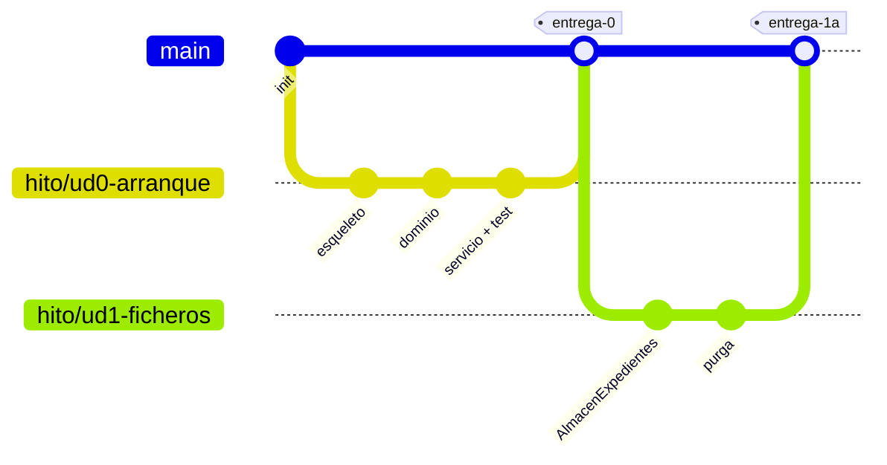

import NextPageButton from '@site/src/components/NextPageButton';

# Flujo de trabajo con Git

En este módulo Git no es una herramienta auxiliar: **es parte del entregable**.
Las entregas se materializan mediante etiquetas en el repositorio y el historial
de commits se evalúa explícitamente.

:::danger[Condición formal de los entregables]

«Historial de commits que evidencie un trabajo progresivo, **no una entrega
única en la fecha límite**.»

Un repositorio con un solo commit llamado «proyecto» el día de la entrega
penaliza aunque el código sea impecable. El historial es la evidencia de que el
trabajo es tuyo y de cómo lo hiciste.

:::

## Creación del repositorio

```bash
cd multagal
git init
git branch -M main
```

En GitHub o GitLab, crea un repositorio **privado** llamado `multagal-<apellido>`
y añade al profesorado como colaborador. Luego:

```bash
git remote add origin git@github.com:usuario/multagal-apellido.git
```

:::tip[Usa SSH, no HTTPS]

Con HTTPS te pedirá un token en cada `push`. Genera una clave y regístrala una
vez:

```bash
ssh-keygen -t ed25519 -C "correo@ejemplo.com"
cat ~/.ssh/id_ed25519.pub    # pega esto en Settings → SSH keys
ssh -T git@github.com        # verificación
```

:::

## El `.gitignore`

Antes del primer commit. Si subes `target/` una vez, limpiarlo del historial es
una operación desagradable.

```gitignore
# Construcción
target/
build/
!.mvn/wrapper/maven-wrapper.jar

# IDE
.idea/
*.iml
.vscode/
.classpath
.project
.settings/

# Sistema operativo
.DS_Store
Thumbs.db

# Credenciales y configuración local  ⚠️
.env
*.local.yml
application-local.yml
src/main/resources/application-secrets.yml

# Datos y logs generados
datos/
logs/
*.log
```

:::warning[Lo que NUNCA se ignora]

- `mvnw`, `mvnw.cmd` y `.mvn/` — sin el wrapper el proyecto no es reproducible.
- `pom.xml`
- `compose.yaml` y `.env.example`
- `src/` completo, incluido `src/test/`

:::

### Si ya has subido algo que no debías

```bash
git rm -r --cached target/
git commit -m "chore: deja de versionar target/"
```

Esto lo saca del seguimiento, **pero sigue en el historial**. Si lo subido era
una contraseña, dala por comprometida y **cámbiala**; no basta con borrarla en
un commit posterior.

## Finales de línea

Un problema real si el grupo mezcla Windows y Linux: los `CRLF` frente a `LF`
hacen que Git vea ficheros enteros como modificados y ensucian los diffs.

Crea `.gitattributes` en la raíz:

```gitattributes
* text=auto eol=lf
*.cmd text eol=crlf
*.bat text eol=crlf
*.jar binary
*.png binary
```

Y en la configuración global:

```bash
# Windows
git config --global core.autocrlf true
# Linux / macOS
git config --global core.autocrlf input
```

## Estrategia de ramas: una rama por hito

Estructura del módulo:

| Rama | Contenido |
|------|-----------|
| `main` | Sólo código estable. Cada hito completado se integra aquí. |
| `hito/ud0-arranque` | Trabajo de la UD0 |
| `hito/ud1-ficheros` | Trabajo de la UD1 |
| `hito/ud2-formatos` | … |
| `fix/<descripcion>` | Corrección puntual sobre `main` |



Ciclo de trabajo de cada hito:

```bash
git switch -c hito/ud0-arranque    # crear y cambiar
# ... trabajo, varios commits ...
git push -u origin hito/ud0-arranque
# → abrir Pull Request hacia main en GitHub
# → revisión entre iguales
git switch main
git merge --no-ff hito/ud0-arranque
git push
```

:::note[`--no-ff`]

Fuerza un commit de fusión aunque Git pudiera hacer un avance rápido. Así el
historial conserva la evidencia de que existió un hito con su conjunto de
commits, en lugar de aplanarlo todo en una línea recta.

:::

## Mensajes de commit

Se exige el formato **Conventional Commits**:

```
<tipo>(<ámbito opcional>): <descripción en imperativo>

[cuerpo opcional: por qué, no qué]
```

| Tipo | Cuándo |
|------|--------|
| `feat` | Nueva funcionalidad |
| `fix` | Corrección de un defecto |
| `refactor` | Cambio interno sin alterar el comportamiento |
| `test` | Añadir o corregir pruebas |
| `docs` | Documentación, Javadoc, ADR |
| `chore` | Construcción, dependencias, configuración |
| `perf` | Mejora de rendimiento |

Ejemplos correctos:

```
feat(dominio): añade los records Expediente, Denuncia e Infraccion
fix(jdbc): cierra el ResultSet en el bloque try-with-resources
refactor(service): extrae el cálculo de la bonificación a un método propio
test(repository): cubre el caso de expediente inexistente
docs(adr): registra la decisión de usar JdbcTemplate sobre JDBC puro
chore(docker): fija la versión de la imagen de PostgreSQL a 16-3.4
```

Y los que no:

```
❌ cambios
❌ arreglado
❌ asdf
❌ commit final
❌ Añadidos ficheros y modificado el servicio y también el pom
```

:::tip[Un commit, una idea]

El último ejemplo falla no por la redacción sino por el contenido: mezcla tres
cosas. Si al escribir el mensaje necesitas la palabra «y», probablemente
debieran ser dos commits.

Frecuencia razonable: cada vez que algo **compila y las pruebas pasan**, y
representa un avance con sentido. Varios commits por sesión de trabajo.

:::

## Etiquetas de entrega

Cada entrega se marca con una etiqueta anotada:

```bash
git tag -a entrega-1 -m "Entrega 1: UD0-UD3. RA1, RA2, RA6 parcial"
git push origin entrega-1
```

```bash
git tag -n              # listar etiquetas con su mensaje
git show entrega-1      # ver a qué commit apunta
```

:::danger[La etiqueta es la entrega]

Se corrige exactamente el commit al que apunta la etiqueta, con la fecha y hora
en que se subió. Lo que hagas después no cuenta. Etiqueta **antes** del plazo,
no en el minuto final: si el `push` falla por lo que sea, has entregado tarde.

:::

Etiquetas del curso:

| Etiqueta | Contenido |
|----------|-----------|
| `entrega-1` | UD0, UD1, UD2, UD3 |
| `entrega-2` | UD4, UD5 |
| `entrega-3` | UD6, UD7 |
| `prueba-final` | Modificación de la prueba práctica |

## Pull requests y revisión entre iguales

Aunque el proyecto es individual, cada hito se integra mediante un **pull
request** sobre tu propio repositorio. Sirve para dos cosas:

1. **Autorrevisión.** Leer el diff completo antes de fusionar detecta bastantes
   despistes: `System.out.println` olvidados, código comentado, ficheros que no
   debían subirse.
2. **Revisión entre iguales.** En las sesiones de revisión se te asignará el PR
   de un compañero o compañera para comentarlo.

Plantilla de descripción del PR:

```markdown
## Hito
UD0 — Arranque

## Qué incluye
- Esqueleto Spring Boot con perfiles dev/prod
- Records del dominio: Expediente, Denuncia, Infraccion, Conductor
- ServicioExpedientes con su prueba unitaria
- compose.yaml con los tres servicios de datos

## Decisiones técnicas
Ver `docs/adr/0001-records-para-el-dominio.md`

## Cómo comprobarlo
```bash
docker compose up -d
./mvnw test
./mvnw spring-boot:run
```

## Pendiente
- Falta el mapeo de Titularidad (se aborda en la UD4)
```

### Qué mirar al revisar el código de otra persona

- ¿Se cierran todos los recursos? (`try-with-resources`)
- ¿Hay credenciales o rutas absolutas escritas en el código?
- ¿Se concatenan parámetros en alguna sentencia SQL?
- ¿La inyección es por constructor?
- ¿Hay estado mutable en un bean singleton?
- ¿Los nombres dicen lo que la cosa hace?
- ¿Las pruebas cubren el caso desfavorable, no sólo el favorable?

Comenta sobre el **código**, no sobre la persona, y propón alternativas
concretas en vez de juicios genéricos.

## El diario técnico en el repositorio

Los ADR viven en `docs/adr/`, numerados:

```
docs/adr/
├── 0001-records-para-el-dominio.md
├── 0002-jdbctemplate-sobre-jdbc-puro.md
└── 0003-modelado-documental-del-expediente.md
```

Se versionan con el código y se commitean con `docs(adr): ...`. La plantilla
está en la [presentación del módulo](/tema-0/a-presentacion-modulo#el-diario-técnico).

## Comandos de supervivencia

```bash
git status                    # qué ha cambiado
git diff                      # cambios sin preparar
git diff --staged             # cambios preparados
git log --oneline --graph --all   # el historial, visualmente
git add -p                    # preparar por trozos, revisando
git restore <fichero>         # descartar cambios no preparados
git restore --staged <fich>   # quitar del área de preparación
git commit --amend            # corregir el ÚLTIMO commit (si no está subido)
git switch -                  # volver a la rama anterior
git stash / git stash pop     # guardar el trabajo a medias
```

:::warning[Nunca reescribas historia ya publicada]

`git commit --amend`, `git rebase` y `git push --force` sobre commits que ya
están en `origin` rompen el repositorio para quien lo haya clonado, y en este
módulo pueden invalidar una etiqueta de entrega. Úsalos sólo sobre trabajo
local, y nunca sobre `main`.

:::

## Errores frecuentes

:::note[«Se me olvidó crear la rama y he trabajado en `main`»]

Si aún no has hecho `push`:

```bash
git switch -c hito/ud0-arranque   # la rama se lleva los commits
git switch main
git reset --hard origin/main      # main vuelve al estado remoto
```

:::

:::note[«`push` rechazado: fetch first»]

El remoto tiene commits que tú no. Integra antes de subir:

```bash
git pull --rebase
git push
```

:::

:::note[«He commiteado el `.env`»]

Sácalo del seguimiento, añádelo al `.gitignore` **y cambia todas las
contraseñas**. Estén o no en el último commit, siguen en el historial.

:::

<NextPageButton to="/tema-0/h-actividades">
Actividades de la unidad
</NextPageButton>
