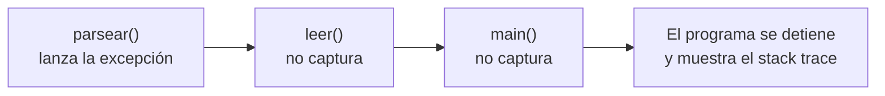
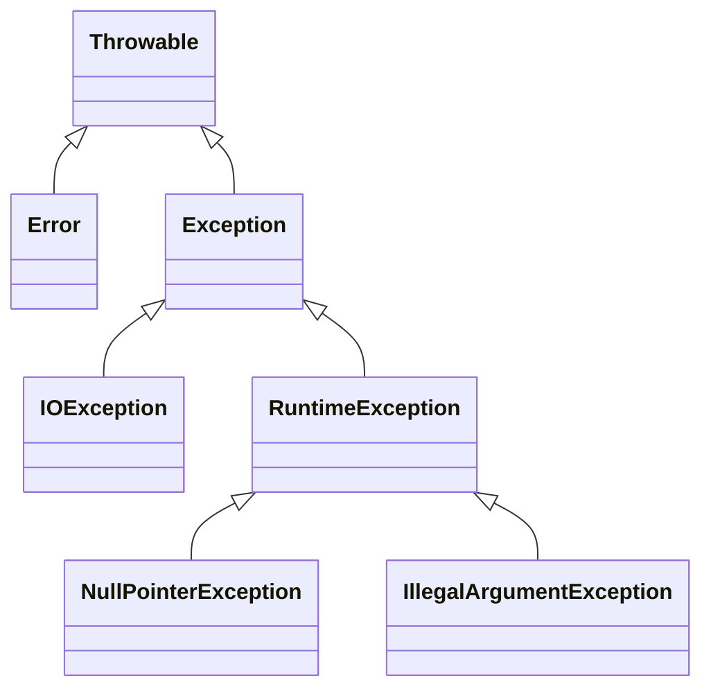
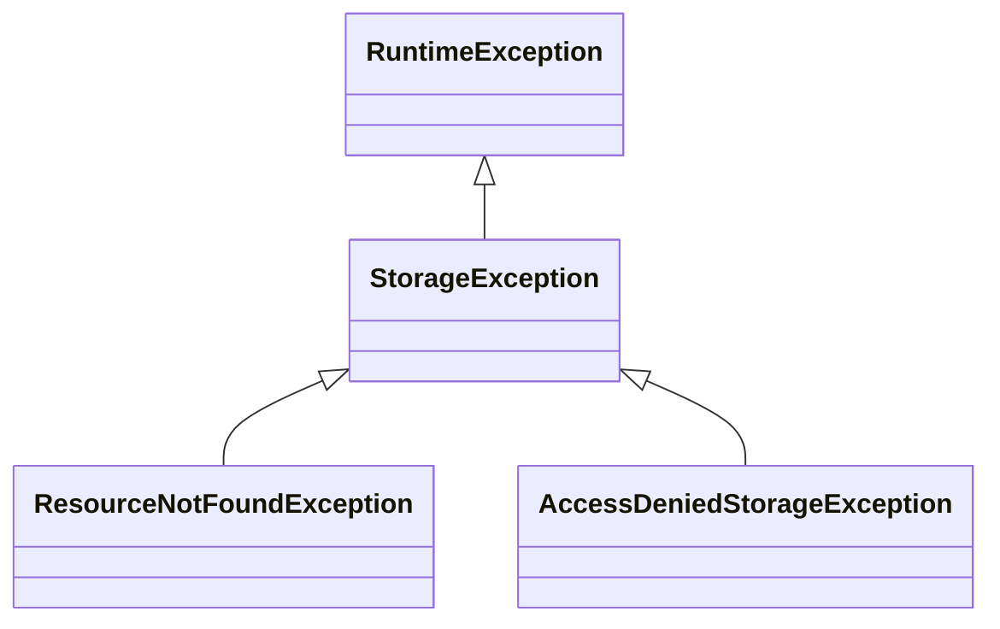
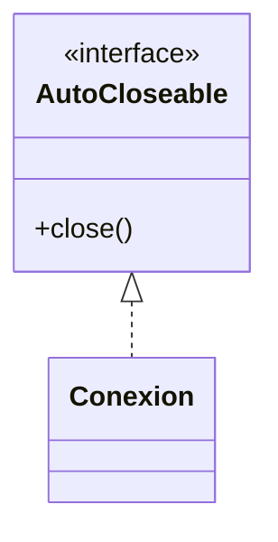

import NextPageButton from '@site/src/components/NextPageButton';

# Excepciones propias y gestión de rutas por configuración

## Qué es una excepción

Una **excepción** es un objeto que interrumpe el flujo normal del programa y
pasa de un método al que lo llamó, y así sucesivamente, hasta que alguien la
captura.

Imagina que `main` llama a `leer()` y esta a `parsear()`, y dentro de
`parsear()` se ejecuta `Integer.parseInt("abc")`:

```java
public static void main(String[] args) {
    leer();
}

static void leer() {
    parsear("abc");
}

static void parsear(String texto) {
    int n = Integer.parseInt(texto); // lanza NumberFormatException
}
```

La excepción sale de `parsear()` y **recorre la pila de llamadas**: cada
método que no la captura queda abortado. Si llega a `main` sin que nadie la
capture, el programa se detiene y la consola muestra el *stack trace*.



### Anatomía de una excepción

Las excepciones pueden producirlas la propia JVM o el código con `throw`:

```java
int x = 10 / 0; // la JVM lanza ArithmeticException

if (edad < 0) {
    throw new IllegalArgumentException("edad negativa");
}
```

Todo objeto excepción lleva tres cosas: el **tipo** (la clase), el
**mensaje** y el **stack trace** (la secuencia de métodos por los que pasó).

:::info
`throw` **lanza** una excepción; `catch` la **captura**. El resto del tema
desarrolla qué hacer con cada una de las dos mitades.
:::

## Comprobadas frente a no comprobadas

Todas las excepciones cuelgan de `Throwable`:



| | Comprobadas (*checked*) | No comprobadas (*unchecked*) |
|---|---|---|
| Superclase | `Exception` (que no sea `RuntimeException`) | `RuntimeException` |
| El compilador obliga a... | capturarlas o declararlas con `throws` | nada; son opcionales de capturar |
| Ejemplo típico | `IOException`, `NoSuchFileException` | `NullPointerException`, `IllegalArgumentException` |
| Cuándo fallan | el código **no compila** si no se tratan | compilan y fallan **al ejecutar** |

```java
// Checked: no compila sin try/catch o throws IOException
String texto = Files.readString(Path.of("datos.txt"));

// Unchecked: compila sin problema y falla al ejecutar
int n = Integer.parseInt("x");
```

`Error` representa fallos de la JVM, como `OutOfMemoryError`. **No se
capturan**: el programa no puede hacer nada razonable al respecto.

:::tip
Para decidir entre checked y unchecked pregúntate: **¿puede el llamador hacer
algo razonable ante este fallo?** Si sí (reintentar, usar otro fichero,
avisar al usuario), checked; si no (un error de programación), unchecked.
:::

Casi todas las excepciones de `java.nio.file` son comprobadas: el compilador
te obliga a decidir qué hacer con ellas al escribir el código, no a
descubrirlo en producción.

## Excepciones propias

Una excepción genérica como `RuntimeException("no existe")` no dice **qué**
ocurrió ni **qué datos** importan. Una excepción propia es una clase más,
y su valor está en los datos que lleva.

### Versión mínima

```java
public class ResourceNotFoundException extends RuntimeException {
    public ResourceNotFoundException(String message) {
        super(message);
    }
}
```

### Con atributos

Si la excepción guarda el recurso y el identificador, el mensaje se
construye dentro de ella y quien la lanza solo aporta los datos:

```java
public class ResourceNotFoundException extends RuntimeException {

    private final String resource;
    private final Object id;

    public ResourceNotFoundException(String resource, Object id) {
        super(resource + " no encontrado con id " + id);
        this.resource = resource;
        this.id = id;
    }

    public String getResource() { return resource; }
    public Object getId() { return id; }
}
```

```java
throw new ResourceNotFoundException("Alumno", 7);
```

### Encadenar la causa

Cuando una excepción se origina por otra, pásala como **causa** con
`super(message, cause)`. Se recupera con `getCause()` y aparece en el stack
trace como «Caused by»:

```java
public class StorageException extends RuntimeException {
    public StorageException(String message, Throwable cause) {
        super(message, cause);
    }
}
```

:::tip
Conserva siempre la excepción original como causa. Perderla hace mucho más
difícil depurar el problema real cuando llegue a producción.
:::

### Jerarquía de dominio

Se suele partir de una excepción base del dominio y subclases por cada caso
que quien captura necesite distinguir:



```java
public class StorageException extends RuntimeException {
    public StorageException(String message, Throwable cause) {
        super(message, cause);
    }
}

public class DocumentNotFoundException extends StorageException {
    public DocumentNotFoundException(String message, Throwable cause) {
        super(message, cause);
    }
}

public class AccessDeniedStorageException extends StorageException {
    public AccessDeniedStorageException(String message, Throwable cause) {
        super(message, cause);
    }
}
```

La clase que encapsula el acceso al sistema de ficheros es el punto natural
para **traducir** las excepciones de `java.nio.file` a las del dominio:

```java
public Document read(Path path) {
    try {
        String content = Files.readString(path);
        return new Document(path.getFileName().toString(), content);
    } catch (NoSuchFileException e) {
        throw new DocumentNotFoundException("No existe el fichero: " + path, e);
    } catch (AccessDeniedException e) {
        throw new AccessDeniedStorageException("Sin permisos para leer: " + path, e);
    } catch (IOException e) {
        throw new StorageException("Error de E/S al leer: " + path, e);
    }
}
```

Así la capa que llama no necesita saber si el dato venía de un fichero, una
base de datos o una API, y puede reaccionar de forma distinta según el caso.

### ¿Checked o unchecked?

Al crear la excepción eliges de qué clase extiende:

- `Exception`: **checked**. Obliga a todos los llamadores a tratarla.
- `RuntimeException`: **unchecked**. Evita `throws` en cada capa intermedia y
  deja la decisión de capturar a la capa que de verdad puede reaccionar.

En aplicaciones modernas lo habitual es que la jerarquía de dominio sea
**no comprobada**.

## try-catch-finally y throws

### try/catch

La excepción se detiene en el `catch` y el programa **continúa** después:

```java
try {
    int n = Integer.parseInt(texto);
    System.out.println("Número: " + n);
} catch (NumberFormatException e) {
    System.out.println("No es un número: " + e.getMessage());
}
System.out.println("El programa sigue");
```

### Varios catch

Se evalúan en orden, así que van **de más específico a más general**. Si
varias excepciones se tratan igual, el *multi-catch* las une con `|`:

```java
try {
    procesar(ruta);
} catch (NoSuchFileException | AccessDeniedException e) {
    System.out.println("No se puede acceder al fichero");
} catch (IOException e) {
    System.out.println("Error de E/S");
}
```

:::danger
Poner `catch (Exception e)` **antes** de una subclase no compila: el
compilador avisa de que la excepción *has already been caught*.
:::

### finally

El bloque `finally` se ejecuta **siempre**, en las tres rutas posibles:

| Ruta | ¿Se ejecuta `finally`? |
|---|---|
| El `try` termina sin error | Sí |
| Hay error y lo captura un `catch` | Sí |
| Hay error y nadie lo captura | Sí, justo antes de propagarse |

```java
try {
    operacion();
} catch (IOException e) {
    System.out.println("Error capturado");
} finally {
    System.out.println("Esto se ejecuta siempre");
}
```

### throws

`throws` **delega** la responsabilidad en el llamador: el método declara que
puede lanzar la excepción y no la trata.

```java
static String leer(Path ruta) throws IOException {
    return Files.readString(ruta);
}
```

| Palabra | Qué hace |
|---|---|
| `throw` | **lanza** una excepción concreta (`throw new ...`) |
| `throws` | **declara** en la firma qué excepciones puede lanzar el método |

:::tip
Captura donde sepas qué hacer con el error; si no lo sabes, propaga.
:::

## try-with-resources

### El problema de `finally`

Cerrar un recurso a mano con `finally` es largo y frágil:

```java
BufferedReader br = null;
try {
    br = Files.newBufferedReader(ruta);
    System.out.println(br.readLine());
} catch (IOException e) {
    System.out.println("Error: " + e.getMessage());
} finally {
    if (br != null) {
        try {
            br.close();          // close() también puede lanzar IOException
        } catch (IOException e) {
            // ¿qué hacemos aquí?
        }
    }
}
```

Hay que inicializar a `null`, comprobar `null` y envolver `close()` en otro
`try/catch`, porque también puede fallar.

### La solución

```java
try (BufferedReader br = Files.newBufferedReader(ruta)) {
    System.out.println(br.readLine());
} catch (IOException e) {
    System.out.println("Error: " + e.getMessage());
}
// br ya está cerrado, haya habido excepción o no
```

La línea de tiempo es siempre: **abrir → usar → cerrar**, y el cierre ocurre
aunque haya excepción.

### Varios recursos

Se declaran separados por `;` y se cierran en **orden inverso** al de
apertura:

```java
try (var entrada = Files.newBufferedReader(origen);
     var salida = Files.newBufferedWriter(destino)) {
    salida.write(entrada.readLine());
}
// primero se cierra salida, después entrada
```

### Recursos propios con `AutoCloseable`

Cualquier clase que implemente `AutoCloseable` puede usarse en el `try ( … )`:



```java
record Conexion(String url) implements AutoCloseable {
    @Override
    public void close() {
        System.out.println("Cerrando " + url);
    }
}

try (var c = new Conexion("jdbc:h2:mem:test")) {
    // usar la conexión
}
```

### Si `close()` también falla

Se conserva la **excepción original** y la del cierre queda como
**suprimida** (`e.getSuppressed()`), en lugar de pisarla como ocurría con
`finally`.

:::info
Todo lo que abras dentro del `try ( … )` se cierra solo. En código nuevo no
hay motivo para cerrar recursos a mano.
:::

## Handler global en Spring Boot

### El problema

Una excepción sin tratar llega al cliente como un **500 con traza**, y poner
`try/catch` en cada controlador es repetitivo. La solución es que el
controlador **lance sin capturar** y que un único componente decida la
respuesta.

```java
@RestController
@RequestMapping("/alumnos")
public class AlumnoController {

    private final AlumnoService service;

    public AlumnoController(AlumnoService service) {
        this.service = service;
    }

    @GetMapping("/{id}")
    public Alumno buscar(@PathVariable long id) {
        return service.buscar(id); // lanza ResourceNotFoundException si no existe
    }
}
```

### `ErrorResponse`

Un `record` con el cuerpo JSON que recibirá el cliente:

```java
public record ErrorResponse(int status, String message, LocalDateTime timestamp) {}
```

### `GlobalExceptionHandler`

`@RestControllerAdvice` equivale a `@ControllerAdvice` + `@ResponseBody`.
Cada método con `@ExceptionHandler` atiende un tipo de excepción:

```java
@RestControllerAdvice
public class GlobalExceptionHandler {

    @ExceptionHandler(ResourceNotFoundException.class)
    public ResponseEntity<ErrorResponse> handleNotFound(ResourceNotFoundException ex) {
        var body = new ErrorResponse(404, ex.getMessage(), LocalDateTime.now());
        return ResponseEntity.status(HttpStatus.NOT_FOUND).body(body);
    }

    // Red de seguridad para cualquier otra excepción
    @ExceptionHandler(Exception.class)
    public ResponseEntity<ErrorResponse> handleGeneric(Exception ex) {
        var body = new ErrorResponse(500, "Error interno del servidor", LocalDateTime.now());
        return ResponseEntity.status(HttpStatus.INTERNAL_SERVER_ERROR).body(body);
    }
}
```

Spring elige siempre el handler **más específico**: una
`ResourceNotFoundException` va al primero y cualquier otra al segundo.


:::tip
El controlador lanza, el handler decide la respuesta.
:::

## Logs en el handler

El handler responde al cliente, pero **el equipo no se entera** del error si
no se registra.

### `@Slf4j` y niveles

Lombok genera el campo `log` con `@Slf4j`:

```java
@Slf4j
@RestControllerAdvice
public class GlobalExceptionHandler {

    @ExceptionHandler(ResourceNotFoundException.class)
    public ResponseEntity<ErrorResponse> handleNotFound(ResourceNotFoundException ex) {
        log.warn("Recurso no encontrado: {}", ex.getMessage());
        // ...
    }

    @ExceptionHandler(Exception.class)
    public ResponseEntity<ErrorResponse> handleGeneric(Exception ex) {
        log.error("Error inesperado: {}", ex.getMessage(), ex);
        // ...
    }
}
```

| Nivel | Cuándo |
|---|---|
| `WARN` | error del **cliente** (404, datos inválidos) |
| `ERROR` | fallo **nuestro** (500) |

Dos buenas prácticas:

- Usa `{}` como marcador en lugar de concatenar cadenas.
- Pasa la excepción como **último argumento** para que salga la traza
  completa.

### Registrar a fichero y a consola a la vez

En `application.yml`:

```yaml
logging:
  file:
    name: logs/app.log
  level:
    root: INFO
    com.ejemplo: DEBUG
```

Y en `logback-spring.xml`, un `ConsoleAppender`, un `RollingFileAppender` con
rotación diaria y un `root` que referencia ambos:

```xml
<configuration>
  <appender name="CONSOLE" class="ch.qos.logback.core.ConsoleAppender">
    <encoder>
      <pattern>%d{HH:mm:ss} %-5level %logger{36} - %msg%n</pattern>
    </encoder>
  </appender>

  <appender name="FILE" class="ch.qos.logback.core.rolling.RollingFileAppender">
    <file>logs/app.log</file>
    <rollingPolicy class="ch.qos.logback.core.rolling.TimeBasedRollingPolicy">
      <fileNamePattern>logs/app.%d{yyyy-MM-dd}.log</fileNamePattern>
      <maxHistory>7</maxHistory>
    </rollingPolicy>
    <encoder>
      <pattern>%d{HH:mm:ss} %-5level %logger{36} - %msg%n</pattern>
    </encoder>
  </appender>

  <root level="INFO">
    <appender-ref ref="CONSOLE"/>
    <appender-ref ref="FILE"/>
  </root>
</configuration>
```

Un `log.error` sale ahora a **dos destinos** con las mismas líneas: la
consola (`java -jar app.jar`) y el fichero (`tail -f logs/app.log`).

:::warning
Añade `logs/` al `.gitignore`: los ficheros de log no se versionan.
:::

El cliente recibe un JSON limpio y **nunca ve la traza**; el log guarda el
detalle para quien deba investigarlo.

### Repaso


## Gestión de rutas por configuración

Escribir una ruta de directorio directamente en el código (`Path.of("/var/datos/entrada")`)
acopla el programa a una máquina concreta. La alternativa es **externalizar**
la ruta a la configuración de la aplicación.

### `@Value`

Para un valor suelto, `@Value` lee una propiedad de configuración y la
inyecta directamente:

```java
import org.springframework.beans.factory.annotation.Value;
import org.springframework.stereotype.Component;
import java.nio.file.Path;

@Component
public class LectorDirectorioEntrada {

    private final Path directorioEntrada;

    public LectorDirectorioEntrada(@Value("${app.directorio-entrada}") String ruta) {
        this.directorioEntrada = Path.of(ruta);
    }
}
```

```yaml
# application.yml
app:
  directorio-entrada: /var/datos/entrada
```

### `@ConfigurationProperties`

Cuando hay **varias rutas relacionadas**, agruparlas en una clase de
propiedades es más mantenible que repetir `@Value` en cada sitio:

```java
import org.springframework.boot.context.properties.ConfigurationProperties;

@ConfigurationProperties(prefix = "app.almacenamiento")
public class AlmacenamientoProperties {

    private String directorioEntrada;
    private String directorioProcesados;
    private String directorioErrores;

    // getters y setters
    public String getDirectorioEntrada() { return directorioEntrada; }
    public void setDirectorioEntrada(String v) { this.directorioEntrada = v; }
    public String getDirectorioProcesados() { return directorioProcesados; }
    public void setDirectorioProcesados(String v) { this.directorioProcesados = v; }
    public String getDirectorioErrores() { return directorioErrores; }
    public void setDirectorioErrores(String v) { this.directorioErrores = v; }
}
```

```yaml
# application.yml
app:
  almacenamiento:
    directorio-entrada: /var/datos/entrada
    directorio-procesados: /var/datos/procesados
    directorio-errores: /var/datos/errores
```

Hay que habilitar el escaneo de esta clase de propiedades una vez en la
configuración de arranque:

```java
import org.springframework.boot.context.properties.EnableConfigurationProperties;

@EnableConfigurationProperties(AlmacenamientoProperties.class)
```

:::tip
`@ConfigurationProperties` valida el tipo de cada propiedad al arrancar la
aplicación (falla rápido si falta una propiedad obligatoria o tiene un tipo
incorrecto) y permite agrupar propiedades relacionadas en un único objeto
inyectable, en lugar de dispersar `@Value` por todo el código.
:::

:::note[«¿Por qué no basta con una constante `static final` en el código?»]
Porque entonces cambiar la ruta exige recompilar y volver a desplegar la
aplicación. Externalizar la ruta a un fichero de configuración permite
ajustarla por entorno (desarrollo, pruebas, producción) sin tocar el
código fuente.
:::

<NextPageButton to="/tema-1/g-streaming-binarios">
Streaming de ficheros binarios grandes
</NextPageButton>
